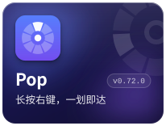
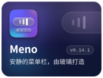
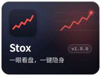
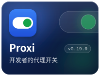
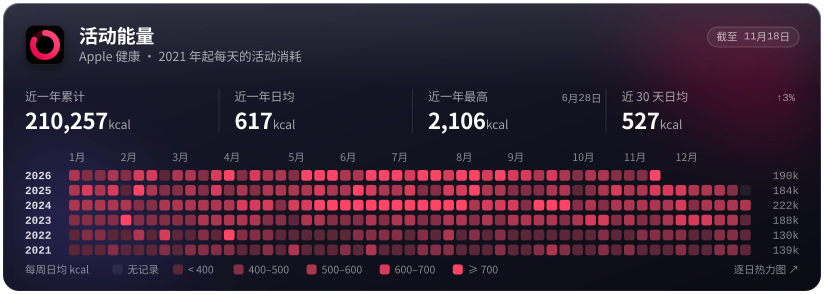

<a href="https://whrss.com">官网</a> · <a href="https://blog.whrss.com">博客</a> · <a href="https://blog.whrss.com/feed.xml">RSS</a> · <a href="mailto:whrss9527@gmail.com">邮箱</a>

<!-- four tiles at 25% fill the row exactly; the comments swallow the line breaks, which would otherwise add gaps -->

  <!--
--><!--
--><!--
-->

| 应用 | 用来做什么 | 系统要求 | 入口 |
| --- | --- | --- | --- |
| [Pop](https://github.com/whrss9527/pop) | 选中文字，长按右键打开翻译、处理文字等工具 | macOS 15+ | [使用说明](https://whrss.com/zh/pop/) · [下载稳定版](https://github.com/whrss9527/pop/releases/latest) |
| [Meno](https://github.com/whrss9527/meno) | 收起菜单栏图标，按需唤回，保存不同场景 | macOS 14+ | [使用说明](https://whrss.com/zh/meno/) · [下载稳定版](https://github.com/whrss9527/meno/releases/latest) |
| [Stox](https://github.com/whrss9527/stox) | 菜单栏行情、持仓盈亏和价格提醒 | macOS 13+ | [使用说明](https://whrss.com/zh/stox/) · [下载稳定版](https://github.com/whrss9527/stox/releases/latest) |
| [Proxi](https://github.com/whrss9527/proxi) | 按配置切换系统、终端、git 和 npm 的代理 | macOS 14+ | [使用说明](https://whrss.com/zh/proxi/) · [下载稳定版](https://github.com/whrss9527/proxi/releases/latest) |

  
  

#### 技术栈

  
  
  
  
  
  
   
  
  
  
  
  
  
   
  
  
  
  

#### 最新文章

<!-- BLOG-POSTS:START -->
`2026-10-04` [猛蹬三天，我做了四个菜单栏 App，然后账号被封了](https://blog.whrss.com/posts/menu-bar-apps-week) 
`2026-10-02` [博客又改了：这次连服务器都不要了](https://blog.whrss.com/posts/blog-goes-static) 
`2026-09-20` [给博客做了一轮大改：多端、离线、服务端渲染和一堆小东西](https://blog.whrss.com/posts/goblog-refactor) 
`2025-11-28` [一致性事务：从 2PC 到 Outbox pattern](https://blog.whrss.com/posts/transaction-consistency-patterns-2pc-outbox) 
`2025-07-20` [鸿蒙 OS 的签名密钥机制，我终于整明白了！](https://blog.whrss.com/posts/harmonyos-signing-key)
<!-- BLOG-POSTS:END -->

数据由 GitHub Action 自动同步，<a href="https://blog.whrss.com/posts/github-poster">做法见这篇</a>

